# KubeCon NA 2026

An unofficial offline app for KubeCon + CloudNativeCon North America 2026 and the CNCF Maintainer Summit (Salt Lake City, November 8–12, 2026), for Android and for iPhone and iPad.

## Install

### Android: [download the APK](https://github.com/intUnderflow/kubecon-na-2026/releases/latest/download/kubecon-na-2026.apk)

Needs Android 12 or later.

1. On your phone, tap the link above to download `kubecon-na-2026.apk`.
2. Open the file. If Android asks, allow your browser or Files app to install apps.
3. Tap **Install**. That's it.

**Updates:** download the new APK from the same link and install it over the old one. Your settings stay.

### iPhone and iPad: [download the iOS app](https://github.com/intUnderflow/kubecon-na-2026/releases/latest/download/kubecon-na-2026.ipa)

Needs iOS 17 or later.

Apple only lets App Store apps install straight from a download, so `kubecon-na-2026.ipa` is unsigned: a sideloading tool signs it with your own Apple ID (a free one works) and installs it.

1. On your Mac or PC, install [AltStore](https://altstore.io) or [Sideloadly](https://sideloadly.io) and connect your iPhone or iPad.
2. Download `kubecon-na-2026.ipa` from the link above and open it with the tool. Sign in with your Apple ID when it asks.
3. On the device, if iOS asks: trust your Apple ID under **Settings → General → VPN & Device Management**, and turn on **Settings → Privacy & Security → Developer Mode** (the device restarts).

With a free Apple ID the app has to be re-signed every 7 days (AltStore can refresh it for you). You can also build it yourself with Xcode: see [Building from source](#building-from-source).

**Updates:** install the new `.ipa` the same way. Your settings stay.

## Screenshots

### Android

| Schedule | Monday | Directions | Session |
|---|---|---|---|
| 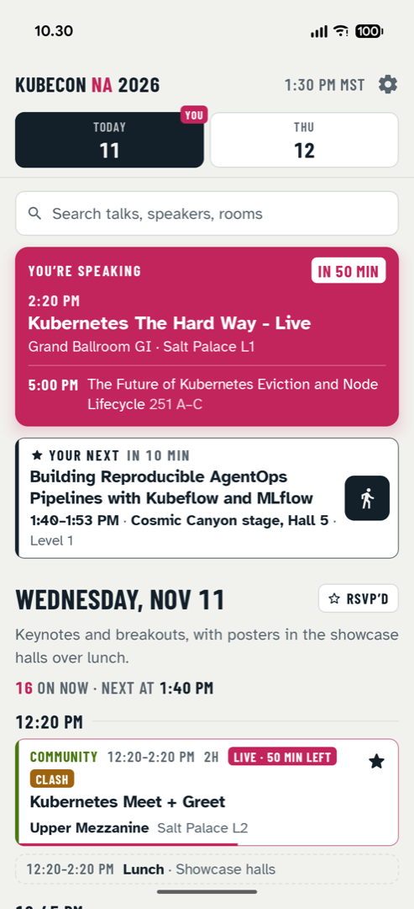 | 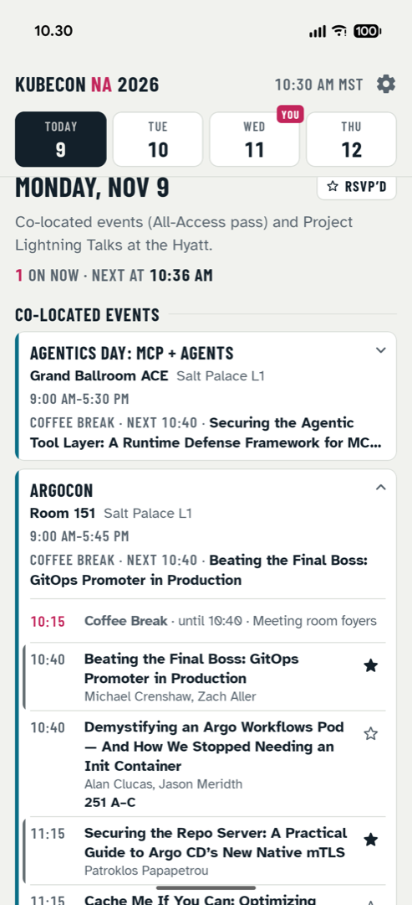 | 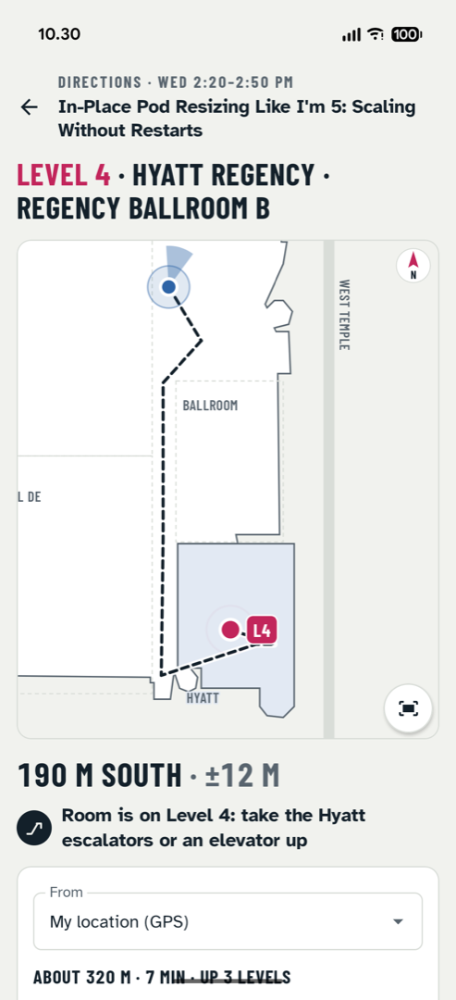 | 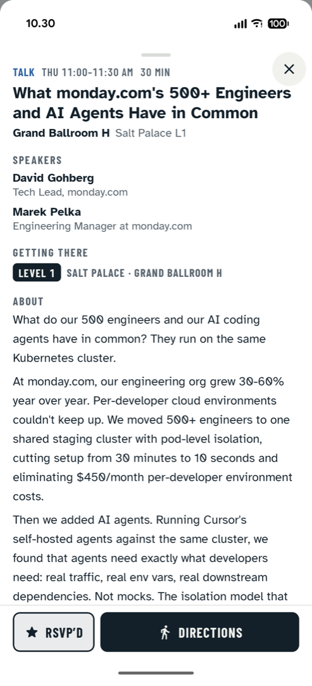 |

| Inner screen: list and detail | Inner screen: directions | Dark theme |
|---|---|---|
| 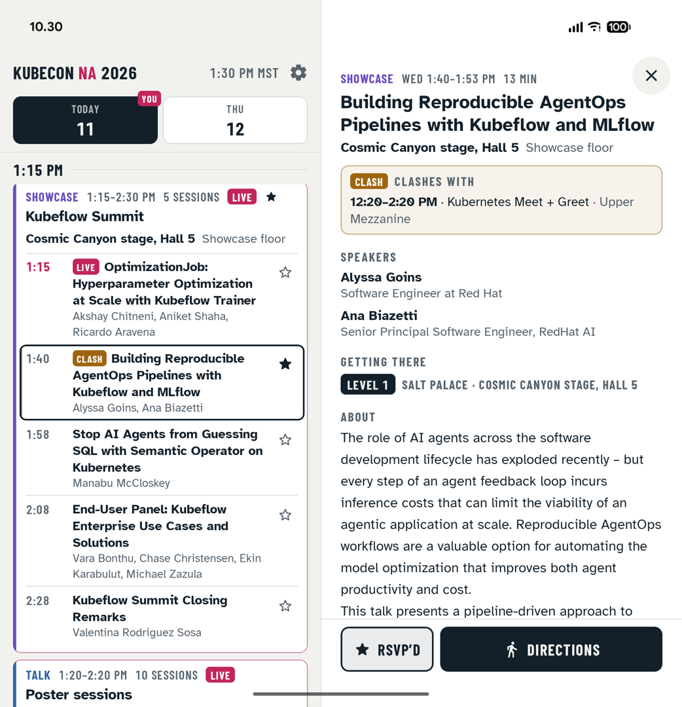 | 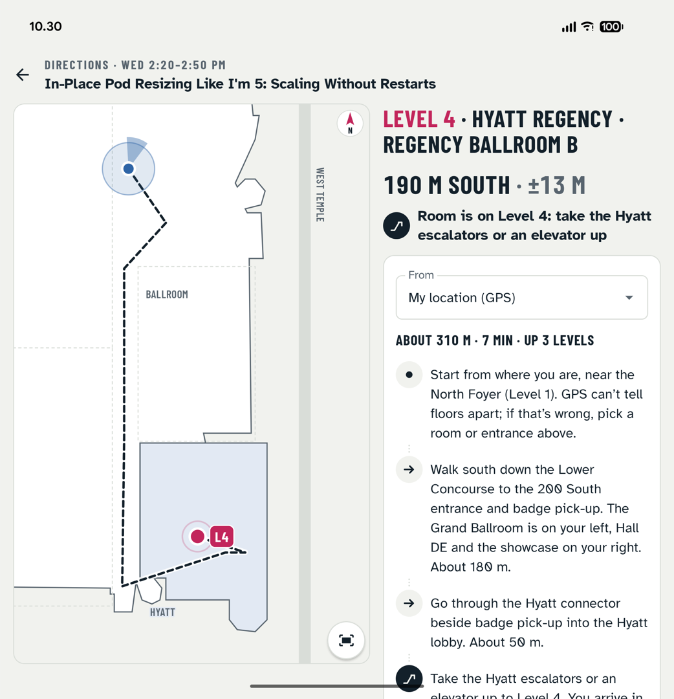 | 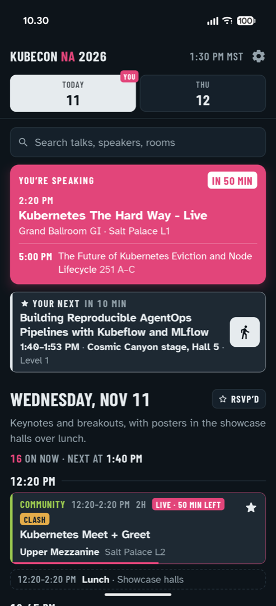 |

### iPhone and iPad

| Schedule | Monday | Directions | Session |
|---|---|---|---|
| 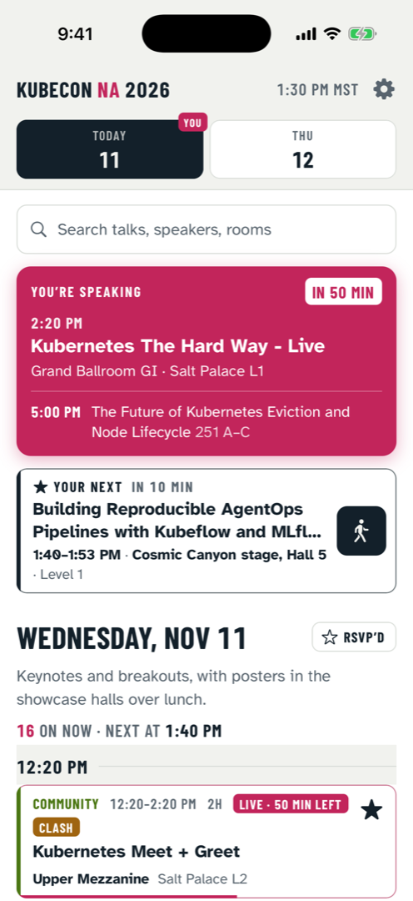 | 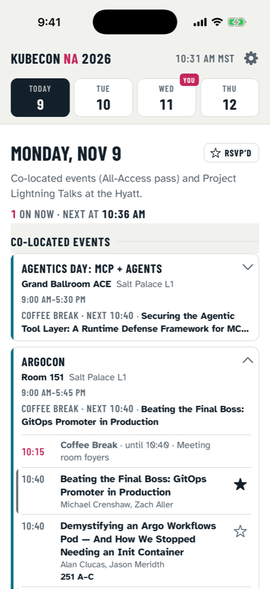 | 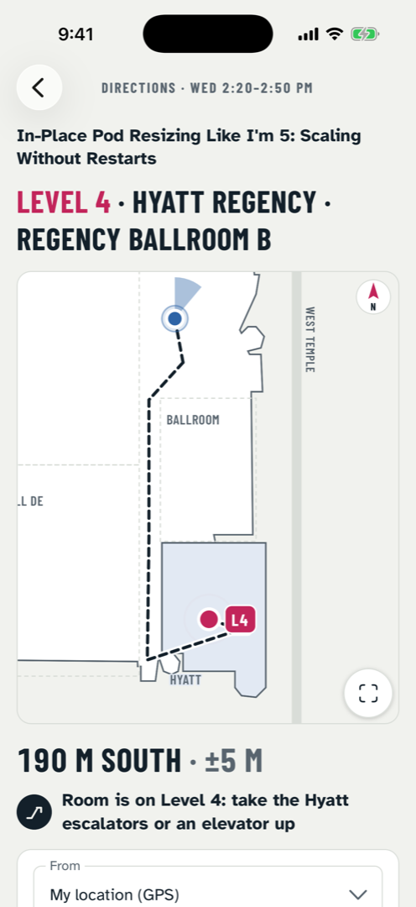 | 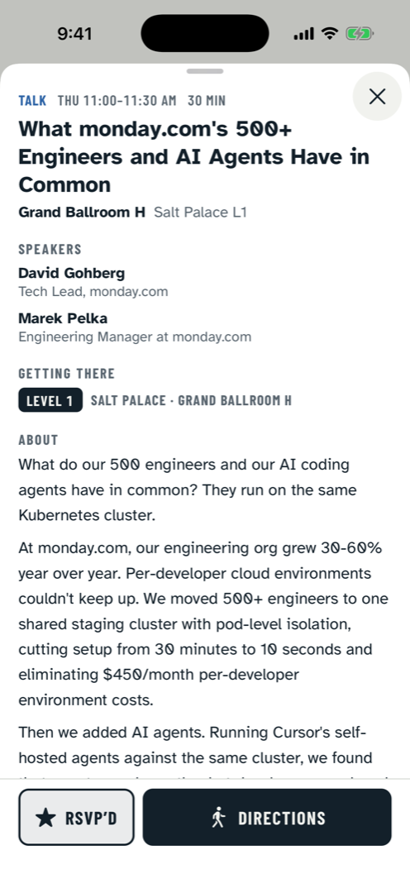 |

| iPad: list and detail | iPad: directions | Dark theme |
|---|---|---|
| 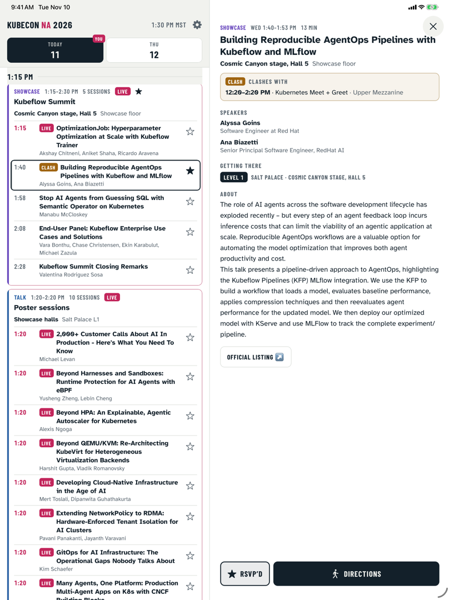 | 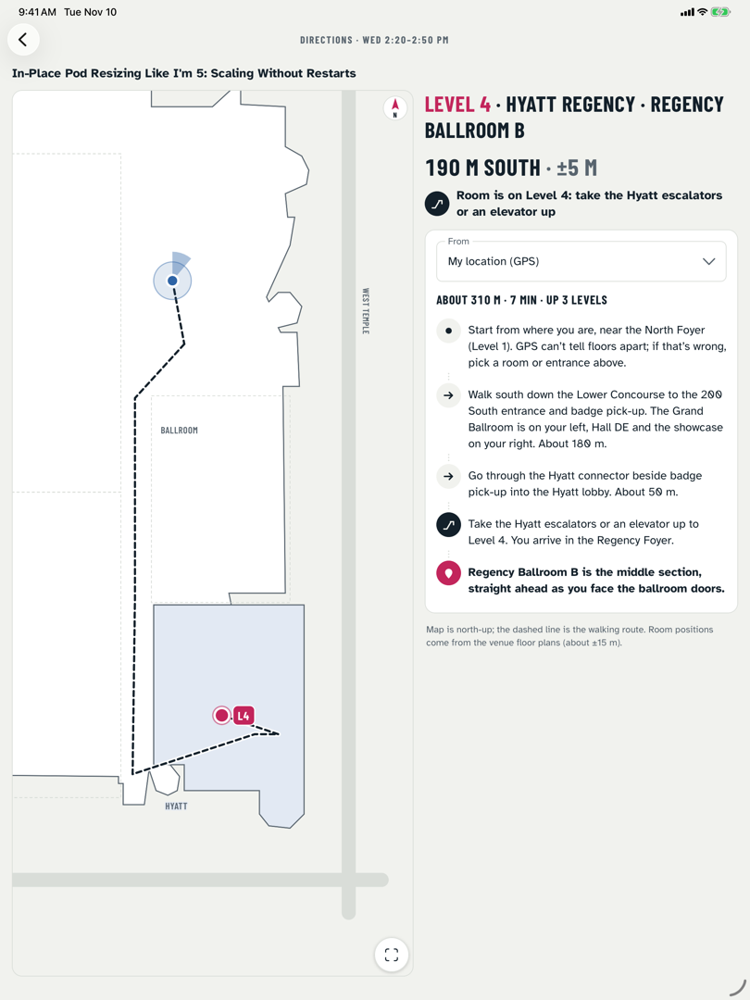 | 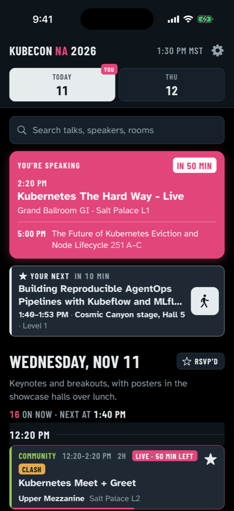 |

## Features

- **Schedule.** Day tabs open on today, in conference time (America/Denver). Sessions sit in half-hour blocks; live sessions show the minutes left, and finished ones drop off. Search covers titles, speakers, rooms and categories for the rest of the week.
- **My talks.** Pick your name under "I'm speaking as" (the app asks on first launch; the default is None). Your talks get a banner, a highlight and a mark on the day tab, plus reminders 30 and 10 minutes before.
- **RSVP.** Tap the star on the sessions you plan to attend. You get a reminder before each one (Off, 5, 10 or 15 minutes; 10 by default), an "Up next" row for today, a note when two RSVP’d sessions clash, and an RSVP’d filter that shows only those sessions and your own talks. RSVPs stay on your device; they don’t register you with the organisers.
- **Co-located events.** Monday's CNCF-hosted co-located events are cards showing what's on now and next, each with its full agenda.
- **Session details.** Full description, speakers and their taglines, room, time and a link to the official page.
- **Indoor directions.** A venue map with your position and step-by-step walking directions between rooms and entrances, with reminders when the route changes floor. The "From" list puts the nearest places first.
- **Offline, with live data updates.** All data ships inside the app. When online, it checks this repository for newer schedule data and switches to it once the download has passed its checks.
- **Foldable and tablet layouts.** One column on a phone or a foldable's cover screen; list and detail side by side on a foldable's inner screen, an iPad or any wide window. Folding, unfolding or resizing keeps your place.
- Talks with Anthropic speakers carry a small Anthropic badge.

## Privacy and permissions

- **Location:** used only while Directions is open, to show where you are (and which way you face) on the map. It stays on the device and is never stored or sent anywhere.
- **Notifications:** for the reminders, which are scheduled on the device (on Android with alarms, re-armed after a reboot; on iOS as local notifications).
- **Network:** the app makes only two kinds of request, and neither sends anything about you:
  - the data update check, which fetches `data/manifest.json` and any changed data files from `raw.githubusercontent.com/intUnderflow/kubecon-na-2026`;
  - session descriptions missing from the bundled data, fetched from Sessionize's public API.
- No accounts, analytics, ads or trackers. Your settings and RSVPs stay on the device.

## Updating the data

Installed apps pick up new data from the `main` branch of this repository: on start, and when they come back to the foreground after at least 15 minutes.

1. `python3 -I scripts/fetch_details.py` refreshes session descriptions (`data/details.json`).
2. `python3 -I scripts/fetch_colocated.py` refreshes the co-located events (`data/colocated.json`, `data/colocated_details.json`).
3. `python3 -I scripts/apply_updates.py <updates file>` applies a day's schedule changes to `data/schedule.json`. If you keep the updates file in `data/updates/`, strip personal fields (such as `youUpvoted`) first.
4. `python3 -I scripts/make_manifest.py --sync-assets` bumps the version in `data/manifest.json` and copies the data into both apps (`android/app/src/main/assets/` and `ios/KCNA26/Resources/Data/`).
5. Run the tests (`cd android && ./gradlew testDebugUnitTest`, and `cd ios/Core && swift test`), then commit and push.

Apps ignore data whose version isn't higher than the one they have, so never hand-edit `data/manifest.json` back to an older version: fix forward (edit the data, run the script, push). Each file is verified by SHA-256 and size, and the whole set is parsed and cross-checked before the app switches to it. If anything fails, the app keeps the data it has.

## Building from source

### Android

You need JDK 17 or later (Android Studio's bundled JDK works) and the Android SDK (compile SDK 37).

The Android app is the Gradle project in `android/`:

```sh
cd android
./gradlew assembleDebug   # app/build/outputs/apk/debug/app-debug.apk
```

Release builds are signed only when these Gradle properties are set, for example in `~/.gradle/gradle.properties` (keep them out of the repository):

```properties
KCNA26_STORE_FILE=/path/to/release.jks
KCNA26_STORE_PASSWORD=…
KCNA26_KEY_ALIAS=…
KCNA26_KEY_PASSWORD=…
```

Without them, `./gradlew assembleRelease` builds an unsigned APK. A fork can point the app at its own data with `-PKCNA26_DATA_BASE_URL=https://raw.githubusercontent.com/<you>/<repo>/main/data/`.

### iOS

You need a Mac with Xcode 16 or later.

1. Open `ios/KCNA26.xcodeproj`.
2. Select the **KCNA26** target, then **Signing & Capabilities**, and pick your team (a free Apple ID works for your own devices). If Xcode says the bundle identifier `app.kcna26` is taken, change it to something of your own.
3. Pick your iPhone, iPad or a simulator and press **Run**.

The app's logic (data, schedule rules, routing, sync, reminders) is a Swift package that builds and tests on macOS and Linux: `cd ios/Core && swift test`. See [ios/README.md](ios/README.md) for how the iOS app is organised. A fork can point the app at its own data with the `KCNA26_DATA_BASE_URL` build setting.

Every push that changes the iOS app (anything in `ios/` except the bundled schedule data) is built and tested by GitHub Actions. Publishing a release (or running the **iOS release** workflow by hand) attaches `kubecon-na-2026.ipa` to it.

## Credits

- Schedule data comes from the official KubeCon + CloudNativeCon North America 2026 and CNCF agendas via Sessionize. Session descriptions and speaker taglines are written by the speakers. The data is not covered by the MIT licence.
- Fonts: [Barlow Condensed](https://github.com/jpt/barlow) and [Atkinson Hyperlegible](https://www.brailleinstitute.org/freefont/), both under the SIL Open Font License 1.1 (see `android/app/src/main/assets/licenses/` and `ios/KCNA26/Resources/Licenses/`).
- App icon: the Kubernetes logo from the CNCF artwork repository (https://github.com/cncf/artwork). Kubernetes is a registered trademark of The Linux Foundation; use follows the Linux Foundation trademark usage guidelines (https://www.linuxfoundation.org/trademark-usage).

This is an unofficial community app. It is not affiliated with or endorsed by the CNCF, the Linux Foundation or Anthropic.

## License

MIT (see [LICENSE](LICENSE)). It covers the code; the schedule data and fonts keep their own terms.
